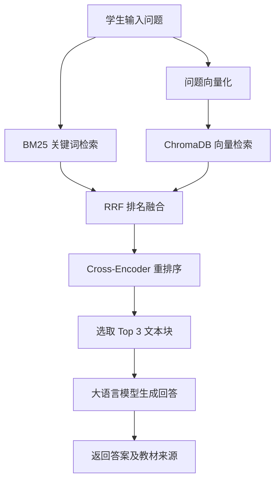

# 课程教学场景智能问答辅助系统

## 项目简介

本项目是一个面向课程教学场景的智能问答辅助系统，作为本科毕业设计项目开发。

系统以课程教材及教学文档为知识来源，结合向量检索、关键词检索与大语言模型生成技术，为学生提供基于课程资料的问答服务。系统在生成回答时引入检索到的教材内容，并返回对应的文档名称和页码，帮助学生定位答案来源。

## 核心功能与技术实现

### 1. 基于教材内容的问答

- 对用户问题进行语义向量化。
- 从课程知识库中检索相关教材文本。
- 将检索到的文本片段作为上下文交由大语言模型生成回答。
- 返回回答及对应的教材来源信息。

### 2. 混合检索与重排序

系统采用多阶段检索策略，提高相关教材内容的召回与排序质量。

- **BM25 关键词检索**：根据问题与教材文本之间的关键词匹配关系进行检索。
- **向量语义检索**：利用文本 Embedding 将问题转换为向量，通过 ChromaDB 检索语义相关内容。
- **RRF 排名融合**：融合关键词检索与向量检索的候选结果。
- **Cross-Encoder 重排序**：对候选文本块进行相关性评分，筛选最终用于回答生成的内容。

### 3. 教材来源追溯

检索过程中保留文本块对应的文档名称、页码等元数据，使问答结果能够关联到原始教材内容。

## 技术栈

| 技术                   | 用途                           |
| ---------------------- | ------------------------------ |
| Python                 | 后端开发                       |
| ChromaDB               | 向量数据存储与检索             |
| Sentence Transformers  | 文本向量化与重排序模型调用     |
| BM25 (rank-bm25)       | 关键词检索                     |
| BAAI/bge-reranker-base | Cross-Encoder 重排序模型       |
| OpenAI Python SDK      | 调用兼容 OpenAI 接口的模型服务 |
| SiliconFlow            | 默认大语言模型 API 服务        |
| Qwen2.5-7B-Instruct    | 默认文本生成模型               |

## RAG 问答流程

## 模型与服务配置

项目通过环境变量配置大语言模型服务：

| 环境变量       | 用途             | 默认值                          |
| -------------- | ---------------- | ------------------------------- |
| `LLM_API_KEY`  | 模型服务 API Key | 无                              |
| `LLM_BASE_URL` | 模型服务接口地址 | `https://api.siliconflow.cn/v1` |
| `LLM_MODEL`    | 使用的生成模型   | `Qwen/Qwen2.5-7B-Instruct`      |

Embedding 模型：

`sentence-transformers/paraphrase-multilingual-MiniLM-L12-v2`

重排序模型：

`BAAI/bge-reranker-base`

模型默认在 CPU 上运行。

## 数据存储

项目使用 ChromaDB 本地持久化存储课程文本块、向量及相关元数据，并按课程划分 Collection。

本地数据库、上传的课程文件及运行环境配置不纳入公开仓库。

## 项目说明

- 本项目为本科毕业设计项目，主要面向课程教材知识检索与问答场景。
- 大语言模型生成的回答依赖检索到的教材上下文，回答内容仍需结合原始教材进行核验。
- 模型服务、模型名称及 API 地址可通过环境变量调整。
